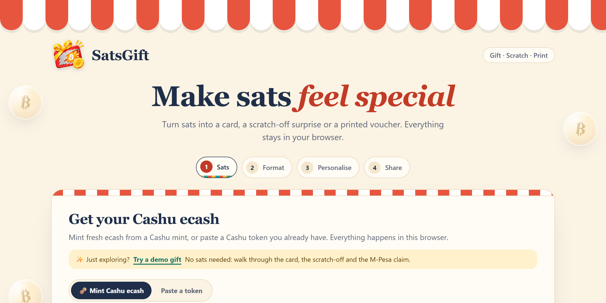
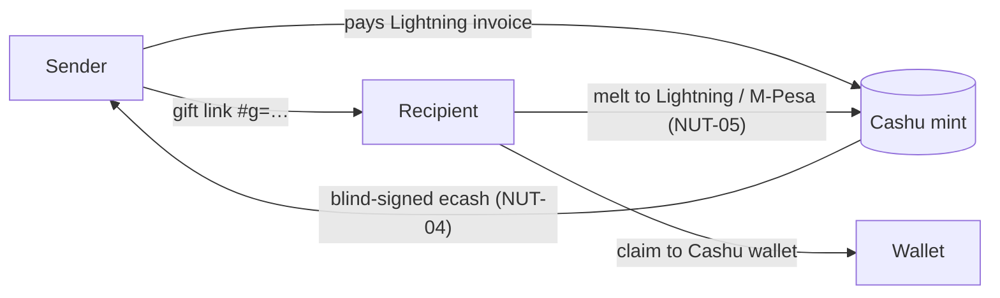
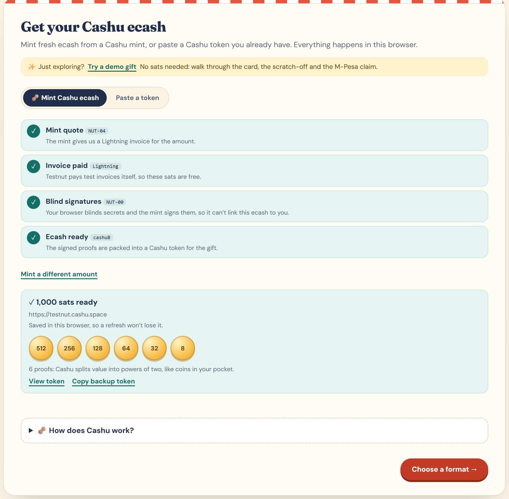
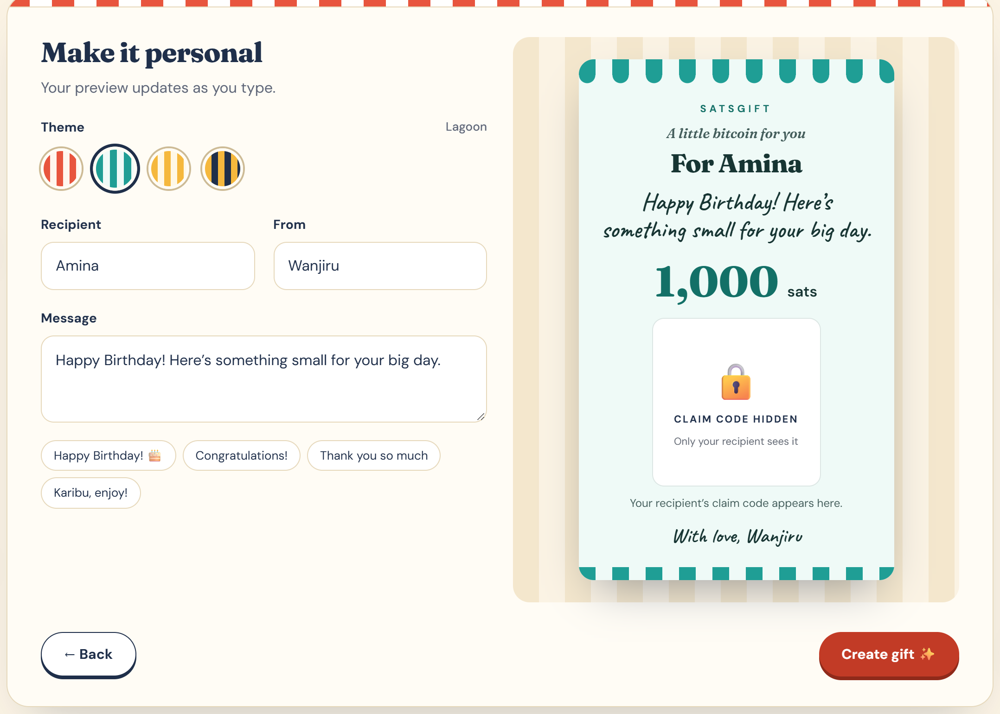
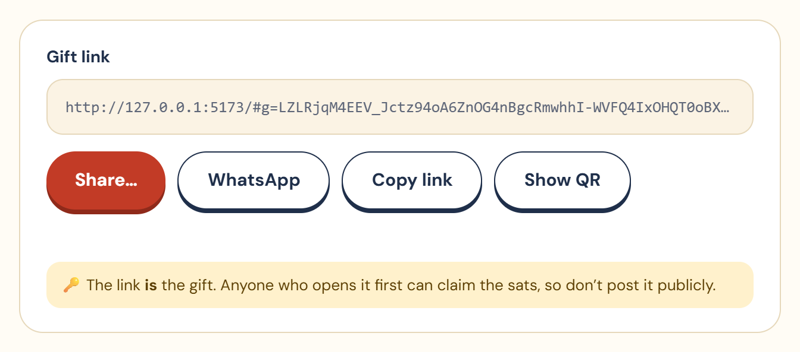
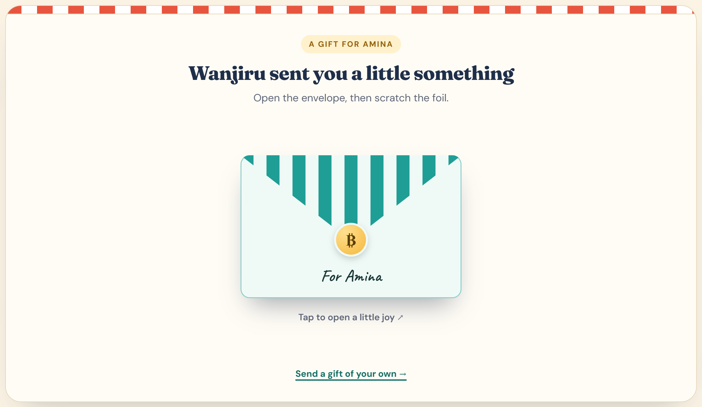
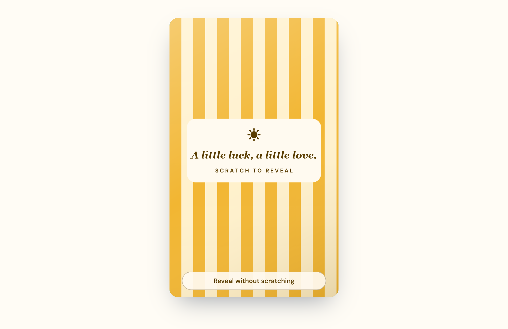
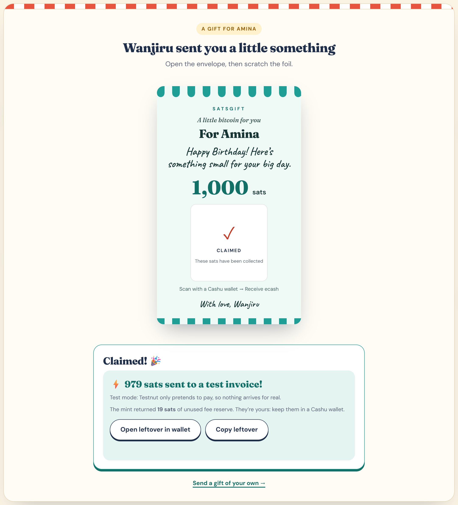

<p align="center">
  
</p>

<h1 align="center">SatsGift</h1>

<p align="center"><b>Make sats feel special.</b><br>
Turn Cashu ecash into a gift card, a scratch-off surprise or a printed voucher, and send it with a link.<br>
The recipient opens an envelope, scratches the foil, and claims the sats to a Cashu wallet, Lightning or M-Pesa.</p>

<p align="center"></p>

---

## Why

Sending bitcoin to a friend usually means a long address, a wallet they don't have yet, and zero ceremony. Cashu ecash changes that: a token *is* the money, so it can travel inside a link, a QR code or a piece of paper, with no accounts on either side.

SatsGift wraps that token in a moment worth opening: a personal card, an envelope, a scratch-off.

## How it works



1. **Get ecash.** Mint fresh Cashu ecash from a mint by paying a Lightning invoice, or paste a token you already have (it's swapped for fresh proofs so the old copy stops working).
2. **Design the gift.** Pick a format (card, scratch card or printable voucher), a theme, a name and a message.
3. **Share a link.** The token and the card are compressed into the link's `#fragment`, which browsers never send to any server. Share it on WhatsApp, by QR, or print it.
4. **Open and claim.** The recipient opens the envelope, scratches the foil, then claims to a Cashu wallet, any Lightning address/invoice, or an M-Pesa number.

## Screenshots

| Mint Cashu ecash | Personalise | Share |
|---|---|---|
|  |  |  |

| The envelope | Scratch to reveal | Claimed |
|---|---|---|
|  |  |  |

## Built on Cashu 🥜

| Spec | What SatsGift uses it for |
|---|---|
| **NUT-00** | Blind signatures and the `cashuB` token format. The mint signs ecash without seeing it, so it can't link a gift to the sender. |
| **NUT-03** | Swap: pasted tokens are exchanged for fresh proofs, which proves they're unspent and invalidates the sender's copy. |
| **NUT-04** | Mint: pay a Lightning invoice, receive ecash. The app shows each step live: quote → paid → blind-signed → ready. |
| **NUT-05** | Melt: recipients claim straight to a Lightning address, invoice, or M-Pesa number, with fees shown first and unused fee reserve returned as change. |
| **NUT-07** | Token state: "Waiting / Claimed ✓" for the sender, and "already claimed" for the recipient. |

Built with [`@cashu/cashu-ts`](https://github.com/cashubtc/cashu-ts) v4, React 19, TypeScript and Vite.

## Features

- **Mint or paste ecash** with a live minting tracker, and see your token as its proofs (512 + 256 + …)
- **Three formats:** digital card in an envelope, scratch-off card (with an accessible "reveal" button), printable voucher
- **Four cabana-stripe themes:** coral, lagoon, sunshine and night
- **Gift links** with no backend: everything lives in the `#fragment`; share via WhatsApp, the phone's share sheet, copy, or QR
- **The sender never sees a claimable code:** previews show a 🔒 hidden claim code
- **Claim anywhere:** Cashu wallet, Lightning address or invoice, or M-Pesa (via Tando's `07…@bitcoin.co.ke` Lightning addresses)
- **Nothing gets lost:** gifts in progress, unpaid invoices and every gift you make are saved in the browser; **Your gifts** shows each one as Waiting or Claimed ✓
- **Demo gift:** walk through the whole flow, including the M-Pesa claim, with no sats and no network calls
- Responsive, keyboard-friendly, reduced-motion aware, with print styles for vouchers

## Try it

SatsGift runs in **test mode** with [Testnut](https://testnut.cashu.space), Cashu's public test mint. Its sats are free and fake: it pays its own invoices.

- **Quickest:** click **Try a demo gift** on the first step.
- **Real test ecash:** click **Mint ecash 🥜**. Testnut pays the invoice for you in a few seconds.
- **Ecash from another Cashu app:** in [Cashu.me](https://cashu.me), add the mint `https://testnut.cashu.space`, mint some sats, tap **Send**, and paste the token into **Paste a token**.
- **Be the recipient:** open the gift link in a private window or on your phone. In the Lightning tab, **Use a test invoice** lets you try a payout without a wallet.

## Run locally

```sh
npm install
npm run dev      # http://127.0.0.1:5173
npm test         # unit tests
npm run build    # production build in dist/
```

## Project layout

```
src/App.tsx              routes: #g=… → recipient page, otherwise the builder
src/pages/               Builder (sender) and Recipient
src/steps/               Fund, Format, Personalise, Share
src/components/          GiftCard, GiftReveal, Scratch, LightningFund, MintSteps,
                         EcashCoins, PasteFund, LightningClaim, MyGifts, CashuExplainer, Shell
src/mint.ts              every mint call (mint, swap, melt, state) and the allowed mints
src/giftLink.ts          encode/decode gifts in the link (deflate + base64url)
src/storage.ts           browser saving: draft, pending invoice, your gifts
src/lnurl.ts             Lightning addresses → invoices (LUD-16), M-Pesa via Tando
src/testInvoice.ts       test mode only: signed throwaway BOLT11 invoices
src/token.ts             token parsing and validation
```

## Privacy and security

- **No backend, no accounts, no analytics.** The app only talks to the Cashu mint, to Lightning-address servers when a recipient claims to one, and to Google Fonts.
- **The link is the money.** Whoever opens it first can claim the sats, so share it privately. The app says so wherever it matters.
- **The mint holds the bitcoin** behind the ecash. Only use mints you trust. SatsGift accepts **test mints only** until real mints are added to `MINTS` in `src/mint.ts`.
- **Browser storage** (localStorage) keeps your backups. Clearing site data deletes them.

## Roadmap

- Real-money mints (Minibits, Coinos, Macadamia…) behind a mint picker
- Mobile-money payouts across Africa via the [BitSpenda](https://developer.bitspenda.app/) API (Ghana, Kenya, Nigeria, Uganda, Cameroon)
- Optional PIN lock on gift links
- "Reclaim" for gifts that were never opened
- Shorter links and QR codes
- Group gifts: several people chip in sats and messages to one card
